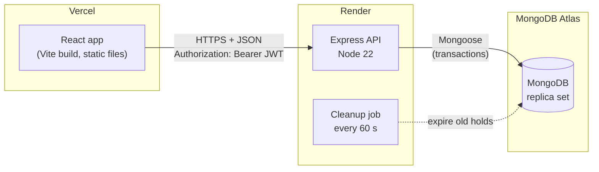

# MySeat

An event ticketing app where people pick seats on a live seat map and book them, built so that two people can never get the same seat.

**Live demo:** https://myseat-app.vercel.app


_Picking seats on the live seat map. Green seats are selected, amber ones are held by other people, grey ones are booked._

> The API runs on Render's free plan, which sleeps when nobody has used it for a while. The first visit can take **about a minute** while it wakes up; the events page says so when it happens. After that it's quick.

### Demo accounts

| Role      | Email               | Password       |
| --------- | ------------------- | -------------- |
| User      | `arjun@example.com` | `Password123!` |
| Organiser | `asha@example.com`  | `Password123!` |

These are public demo accounts, so please don't put anything real in them.

### Try hosting an event yourself

1. **Sign up** with any email (you start as a normal user).
2. Click your **name in the navbar** to open your account, enter an organisation name, and choose **Switch to organiser account**.
3. You land on your organiser dashboard. Choose **Create your first event**, set the date, price and seat layout, and save.
4. Your event appears on the public events list, showing your organisation as the host.

## What it does

- **Users** browse upcoming events (filter by city), pick up to 6 seats on a seat map that refreshes every 5 seconds, hold them for 5 minutes, pay (simulated) and get a ticket. They can see and cancel their bookings.
- **Organisers** create events with a seat layout (rows A–Z × seats per row), edit details, cancel events, and see how many seats are available, held and booked. Any user can become an organiser from their account page; events show the organisation that hosts them.

## Key engineering decisions

- **Atomic conditional seat holds.** Each seat is claimed with a single `findOneAndUpdate` whose filter says "only if it's still free", so checking and claiming happen in one step and a race between two buyers can't sell a seat twice.
- **Transactions for multi-seat holds.** Holding several seats runs in a MongoDB transaction, so if any one seat is taken, the whole hold is rolled back: all seats or none.
- **Lazy hold expiry plus a cleanup job.** An expired hold counts as free the moment its time is up, with no timers needed. A job every 60 seconds only tidies the database, so correctness never depends on it.
- **Idempotency keys.** The app sends an `Idempotency-Key` with each hold, so a request retried after a network drop returns the original booking instead of creating a second one; a unique index covers two copies arriving at the same instant.
- **Rate limiting.** Login and sign-up are limited per IP (20 per 15 minutes) to slow down password guessing; seat holds are limited per user, so people sharing one Wi-Fi don't block each other.
- **JWT auth and role guards.** Passwords are stored as bcrypt hashes; a signed token identifies the user, and middleware checks both the role (organiser) and ownership (your event, your booking) on every request. Because the role is stored inside the token, switching to an organiser account issues a fresh token.

## Testing

**108 automated tests** (Vitest + Supertest) run against a throwaway in-memory MongoDB, never the real database. They cover auth, events, bookings and security (rate limits, error responses, headers). Highlights:

- **Concurrency:** 20 users try to hold the same seat at the same moment. Every run, exactly 1 succeeds, 19 get `409`, and the seat belongs to the winner.
- **All-or-nothing:** if one seat in a group is taken, none are held, including when the quick pre-check read was out of date.
- **Idempotency:** the same key sent twice, even simultaneously, creates only one booking.
- **Expiry:** real 1-second holds expire, the seat can be taken by someone else, and the late confirm gets `409`.

CI (GitHub Actions) runs server lint and tests, and client lint and build, on every push and pull request.

### Load test

`npm run loadtest` fires **500 simultaneous requests** at the real server and Atlas database. In every run, no seat was ever given to two people and no request errored. Adding a fast-fail check (reject a clearly taken seat before opening a transaction) made the common "seat already gone" case about 3× faster:

| Scenario                           | Run    | 201 / 409 | p50       | p95       |
| ---------------------------------- | ------ | --------- | --------- | --------- |
| A: 500 users, 1 free seat          | Before | 1 / 499   | 33.9 s    | 35.8 s    |
|                                    | After  | 1 / 499   | 33.9 s    | 35.8 s    |
| B: 500 users, 100 seats            | Before | 100 / 400 | 25.8 s    | 26.9 s    |
|                                    | After  | 99 / 401  | 25.9 s    | 27.9 s    |
| C: 500 users, 1 already-taken seat | Before | 0 / 500   | 16.9 s    | 19.0 s    |
|                                    | After  | 0 / 500   | **5.9 s** | **7.9 s** |

The absolute times are slow because the free Atlas tier handles only about 140 operations per second. Measuring each layer showed that, not the app code, was the bottleneck. Full results, method and what I learned: [docs/load-test-results.md](docs/load-test-results.md).

## Architecture



The browser loads the React app from Vercel, then calls the API on Render directly (CORS allows only the frontend's address). Inside the API, each request goes **route → controller → service → model**: routes apply auth and rate limits, controllers check input and pick the HTTP status, services hold the business logic, and models talk to MongoDB.

## Tech stack

| Layer    | Tools                                                            |
| -------- | ---------------------------------------------------------------- |
| Frontend | React 19, Vite, Tailwind CSS 4, React Router 7                   |
| Backend  | Node.js 22, Express 5 (ES modules), Mongoose                     |
| Database | MongoDB Atlas (replica set, needed for transactions)             |
| Auth     | bcrypt, jsonwebtoken                                             |
| Security | helmet, express-rate-limit, cors                                 |
| Testing  | Vitest, Supertest, mongodb-memory-server, a plain-Node load test |
| Tooling  | ESLint, Prettier, nodemon, GitHub Actions                        |
| Hosting  | Vercel (frontend), Render (API), MongoDB Atlas M0 (database)     |

## Running locally

**You need:** Node.js 22.12+, npm, and a MongoDB connection string (a free Atlas cluster works).

```bash
# 1. API
cd server
npm install
cp .env.example .env     # then fill in MONGO_URI and JWT_SECRET (see comments in the file)
npm run seed             # sample data; WARNING: deletes existing users, events, seats and bookings
npm run dev              # http://localhost:5000  (check /api/health)

# 2. Frontend, in a second terminal
cd client
npm install
npm run dev              # http://localhost:5173
```

The frontend uses `VITE_API_URL` (default `http://localhost:5000`; see `client/.env.example`).

**Useful scripts**

| Where    | Command            | What it does                                              |
| -------- | ------------------ | --------------------------------------------------------- |
| `server` | `npm test`         | All automated tests (in-memory database)                  |
| `server` | `npm run lint`     | ESLint                                                    |
| `server` | `npm run loadtest` | 500-user load test against the running server (cleans up) |
| `client` | `npm run lint`     | ESLint, including React Hooks rules                       |
| `client` | `npm run build`    | Production build into `client/dist/`                      |

To try the API by hand, open the files in `requests/` with the VS Code REST Client extension. Deploying your own copy: [docs/DEPLOY.md](docs/DEPLOY.md).

## API endpoints

Send the token as `Authorization: Bearer <token>`. Prices are in paise (₹1 = 100 paise).

| Method | Path                         | Auth             | Description                                                                                                                      |
| ------ | ---------------------------- | ---------------- | -------------------------------------------------------------------------------------------------------------------------------- |
| GET    | `/api/health`                | No               | Server and database status                                                                                                       |
| POST   | `/api/auth/register`         | No               | Create an account (role is always `user`). Rate limited                                                                          |
| POST   | `/api/auth/login`            | No               | Log in; returns a JWT and the user. Rate limited                                                                                 |
| GET    | `/api/auth/me`               | Yes              | The logged-in user                                                                                                               |
| POST   | `/api/auth/become-organiser` | Yes              | Switch your account to organiser: `{ organisationName }` (2–80 chars). Returns a new token and user. 400 if already an organiser |
| GET    | `/api/events`                | No               | Upcoming events. Query: `page`, `limit` (max 50), `city`                                                                         |
| GET    | `/api/events/cities`         | No               | Cities with upcoming events, A to Z                                                                                              |
| GET    | `/api/events/mine`           | Organiser        | Your events (any status) with seat counts by status                                                                              |
| GET    | `/api/events/:id`            | No               | One event with its seat map                                                                                                      |
| POST   | `/api/events`                | Organiser        | Create an event and its seats (max 26 rows × 50 seats)                                                                           |
| PATCH  | `/api/events/:id`            | Owning organiser | Update title, venue, city, start time or price                                                                                   |
| POST   | `/api/events/:id/cancel`     | Owning organiser | Cancel the event and its pending/confirmed bookings                                                                              |
| POST   | `/api/bookings/hold`         | Yes              | Hold 1–6 seats: `{ eventId, seatLabels }`, optional `Idempotency-Key`. 201 new, 200 replay, 409 taken. Rate limited              |
| POST   | `/api/bookings/:id/confirm`  | Booking owner    | Confirm a hold (simulated payment). 409 if the hold expired or was lost                                                          |
| POST   | `/api/bookings/:id/cancel`   | Booking owner    | Cancel before the event starts; frees the seats                                                                                  |
| GET    | `/api/bookings/me`           | Yes              | Your bookings, newest first                                                                                                      |
| GET    | `/api/bookings/:id`          | Booking owner    | One booking with event and seat details                                                                                          |

Booking statuses: `pending` (held) → `confirmed`, or `expired` (hold ran out) / `cancelled`.

## Known limitations and next steps

- **Free-tier latency.** The API sleeps after inactivity (about a minute to wake), and the free database caps throughput at roughly 140 operations per second. A paid tier, or fewer database calls per hold, would fix both.
- **Polling instead of websockets.** The seat map asks the server for changes every 5 seconds, so other people's holds can take up to 5 seconds to appear. The server still prevents double-booking regardless; websockets or server-sent events would make the map update instantly.
- **Simulated payment.** "Pay and confirm" doesn't charge anything. A real version would use a payment provider and confirm the booking from its webhook.
- **Tokens in localStorage.** Simple, but readable by any script on the page if an XSS bug ever slipped in. An httpOnly cookie (with CSRF protection) is the safer production choice.
- **Smaller gaps.** Creating an event and its seats isn't one transaction yet (the same pattern as holds would fix it); rate-limit counters live in memory, so they reset on restart and wouldn't be shared across several servers (a Redis store would fix that); cancelling an event doesn't release its seats.

## Screenshots

In the order a visitor goes through the app.

**1. Events.** Upcoming events with the host, date, venue and price per seat, a city filter and pages.


**2. Seat map.** Pick up to 6 seats; the map refreshes every 5 seconds so other people's holds appear.


**3. Checkout.** Seats are held for 5 minutes while you pay. Payment is simulated.


**4. Ticket.** After confirming, the booking is shown as a simple ticket stub.


**5. Organiser dashboard.** Organisers see their events with available, held and booked seat counts, and can edit or cancel them.


## More docs

- [docs/DEPLOY.md](docs/DEPLOY.md): step-by-step deployment to Render, Vercel and Atlas
- [docs/load-test-results.md](docs/load-test-results.md): load test method, numbers and findings
- [docs/interview-notes.md](docs/interview-notes.md): how everything works, in plain English
