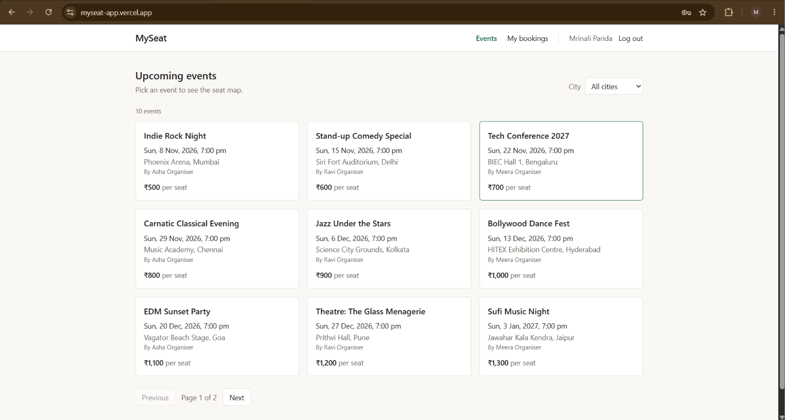
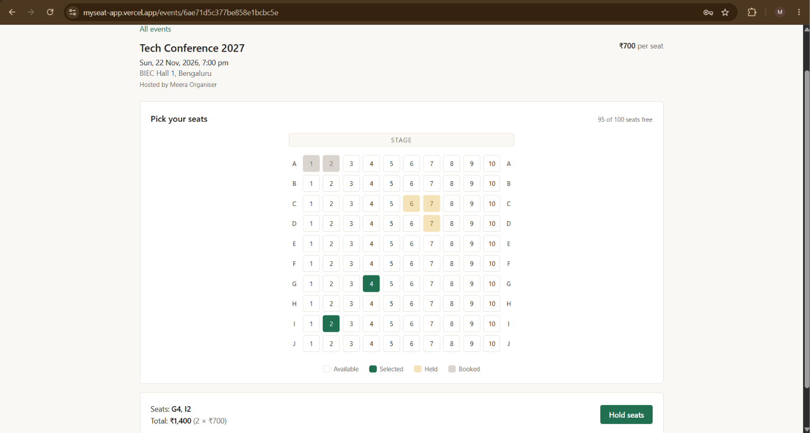
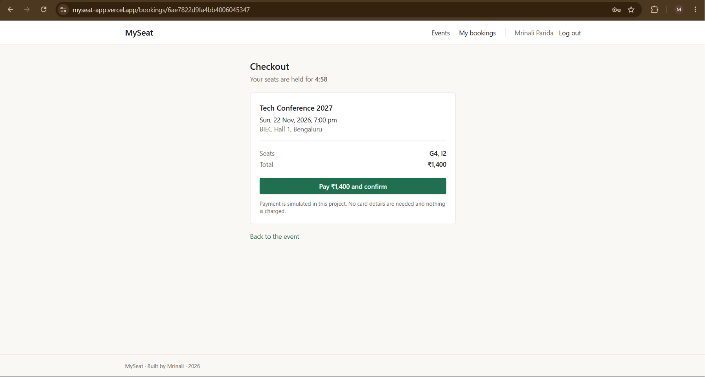
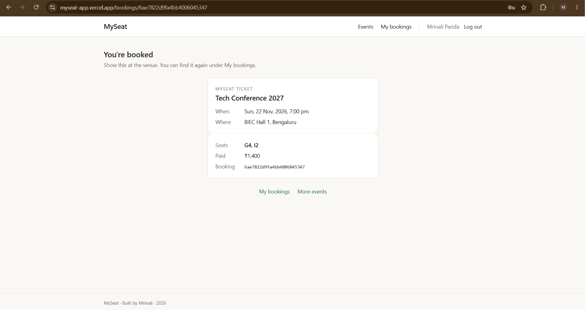
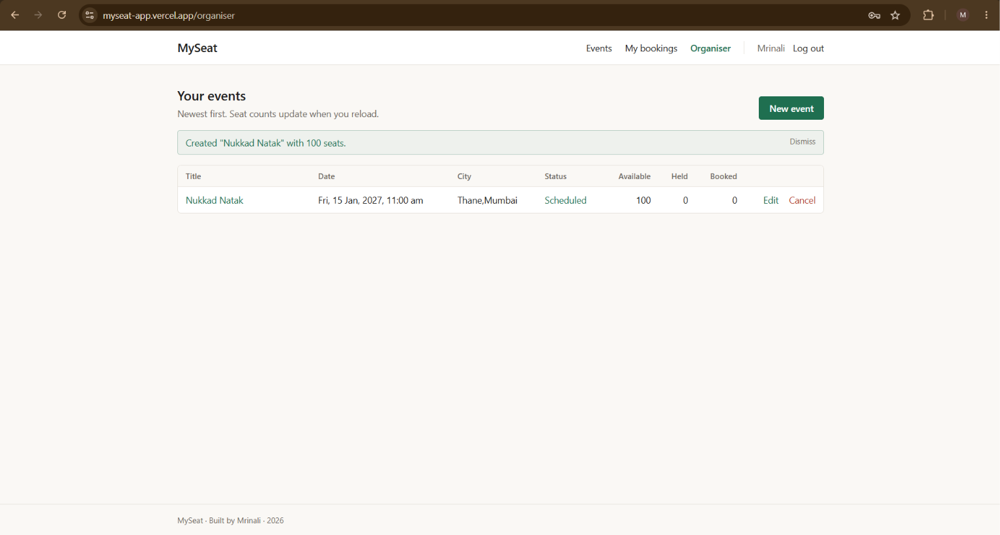

# MySeat

An event ticketing system built with the MERN stack: organisers publish events with a seat map, and users hold, confirm and cancel seat bookings without ever double-selling a seat.

## Features (done so far)

- **Auth**: register, login with JWT, `GET /me` for the current user
- **Roles**: `user` and `organiser`, enforced by middleware
- **Events**: organisers create events; a seat map (rows A, B, C… × seats per row) is generated automatically
- **Browsing**: public list of upcoming events with pagination and city filter; event details with seats
- **Event management**: the owning organiser can update details or cancel an event (which also cancels its active bookings), and list all their events with seat counts (available / held / booked)
- **Seat holds**: hold 1–6 seats for a few minutes (`HOLD_DURATION_SECONDS`, default 300). Each seat is claimed with one atomic update inside a MongoDB transaction, so a seat can never be sold twice and a hold is all-or-nothing
- **Idempotent holds**: send an `Idempotency-Key` header and a retried request returns the original booking instead of creating a second one
- **Confirm & cancel**: confirming turns held seats into booked ones (payment is simulated); cancelling frees the seats again. Both run in transactions
- **Expired holds**: treated as free immediately; a cleanup job also tidies them up every 60 seconds
- **My bookings**: list and view your own bookings with event and seat details
- **Frontend**: React app covering the whole user flow. Browse events (city filter, pagination), pick up to 6 seats on a live seat map (refreshes every 5 seconds), hold them, pay on a checkout page with a countdown (payment is simulated), get a ticket stub, and view or cancel bookings in a table. Organisers get a dashboard with seat counts per event, plus forms to create, edit and cancel events
- **Tests**: 96 integration tests against an in-memory MongoDB, including a concurrency test where 20 users grab the same seat at once and exactly one wins
- **Load test**: 500 simultaneous users against the real server + Atlas; no seat ever double-booked. A fast-fail check made "seat already taken" bursts about 3× faster ([results](docs/load-test-results.md))

## Tech stack

| Layer    | Tools                                         |
| -------- | --------------------------------------------- |
| Backend  | Node.js 20+, Express 5, ES modules            |
| Database | MongoDB (Atlas) with Mongoose                 |
| Auth     | bcrypt (password hashing), jsonwebtoken (JWT) |
| Testing  | Vitest, Supertest, mongodb-memory-server      |
| Tooling  | ESLint (flat config), Prettier, nodemon       |
| Frontend | React 19, Vite, Tailwind CSS 4, React Router  |

## Folder structure

```
ticketing/
├── client/                 # React frontend (Vite)
│   └── src/
│       ├── api/            # fetch wrapper (client.js) + session storage
│       ├── auth/           # AuthContext: login, register, logout, current user
│       ├── components/     # Layout, Navbar, Footer, route guards, form pieces
│       ├── hooks/          # useFetch, useNow, useTitle, useFlash
│       ├── pages/          # One file per page
│       └── utils/          # Form validation, price/date formatting, booking status helpers
├── docs/                   # Notes, e.g. interview-notes.md
├── requests/               # VS Code REST Client files (auth, events, bookings)
└── server/
    ├── scripts/            # seed.js, test-expired-token.js
    ├── tests/              # Vitest setup, helpers and test files
    └── src/
        ├── app.js          # Express app: middleware + routes (no DB connection)
        ├── index.js        # Entry point: loads .env, connects to DB, starts server
        ├── config/         # db.js (MongoDB connection)
        ├── routes/         # URL → middleware → controller
        ├── controllers/    # Read the request, validate input, send the response
        ├── services/       # Business logic and database work
        ├── models/         # Mongoose schemas: User, Event, Seat, Booking
        ├── middleware/     # requireAuth, requireRole
        ├── jobs/           # expireHolds.js (cleanup of expired seat holds)
        ├── errors/         # httpError helper (Error with an HTTP status)
        └── validators/     # (planned)
```

## Running locally

**Requirements:** Node.js 20+, npm, and a MongoDB connection string (e.g. a free MongoDB Atlas cluster).

1. **Install dependencies**

   ```bash
   cd server
   npm install
   ```

2. **Set environment variables**: copy `server/.env.example` to `server/.env` and fill it in:

   | Variable                | Example                               | Purpose                                            |
   | ----------------------- | ------------------------------------- | -------------------------------------------------- |
   | `MONGO_URI`             | `mongodb://localhost:27017/ticketing` | MongoDB connection string                          |
   | `JWT_SECRET`            | a long random string                  | Signs and verifies JWTs                            |
   | `JWT_EXPIRES_IN`        | `1d`                                  | How long a login token lasts                       |
   | `PORT`                  | `5000`                                | Port the API listens on                            |
   | `NODE_ENV`              | `development`                         | Environment name                                   |
   | `HOLD_DURATION_SECONDS` | `300`                                 | How long a seat hold lasts (optional, default 300) |
   | `CLIENT_URL`            | `http://localhost:5173`               | Frontend origin allowed by CORS (optional)         |

3. **Seed sample data** (warning: deletes existing users, events, seats and bookings first)

   ```bash
   npm run seed
   ```

   Creates 3 organisers (`asha@`, `ravi@`, `meera@example.com`), 5 users, 10 events and 1000 seats. Every account's password is `Password123!`.

4. **Start the dev server** (restarts on file changes)

   ```bash
   npm run dev
   ```

   The API runs at `http://localhost:5000`. Check `GET /api/health`.

5. **Run the tests** (use an in-memory database, never your real one)

   ```bash
   npm test            # run once
   npm run test:watch  # re-run on changes
   ```

6. **Start the frontend** (in a second terminal, while the API is running)

   ```bash
   cd client
   npm install
   cp .env.example .env   # optional: only needed if the API isn't on http://localhost:5000
   npm run dev
   ```

   Open `http://localhost:5173`. Log in with a seeded account, e.g. `arjun@example.com` (user) or `asha@example.com` (organiser), password `Password123!`.

Other server scripts: `npm run lint`, `npm run format`, `npm run test:expiry` (manual JWT expiry check against the running server), `npm run loadtest` (500-user load test against the running server and real database; cleans up after itself and updates `docs/load-test-results.md`).

To try the API by hand, open `requests/auth.http`, `requests/events.http` or `requests/bookings.http` with the VS Code **REST Client** extension and send the requests top to bottom. `bookings.http` walks through the whole flow: hold, idempotent retry, a competing user getting 409, confirm, list and cancel.

## Frontend

The React app lives in `client/` (Vite, React 19, React Router 7, Tailwind CSS 4).

**Setup**

1. Start the API first (see "Running locally" above). The frontend talks to it from the browser, so the API must allow the frontend's address via CORS: `CLIENT_URL` in `server/.env` (default `http://localhost:5173`).
2. Install and run:

   ```bash
   cd client
   npm install
   npm run dev
   ```

3. Open `http://localhost:5173`.

**Environment variables** (`client/.env`, copy from `client/.env.example`; optional)

| Variable       | Default                 | Purpose                  |
| -------------- | ----------------------- | ------------------------ |
| `VITE_API_URL` | `http://localhost:5000` | Where the API is running |

**Scripts**

| Command           | What it does                            |
| ----------------- | --------------------------------------- |
| `npm run dev`     | Dev server with hot reload on port 5173 |
| `npm run build`   | Production build into `client/dist/`    |
| `npm run preview` | Serve the production build locally      |
| `npm run lint`    | ESLint, including the React Hooks rules |
| `npm run format`  | Prettier                                |

**Pages**

| Path                         | Who           | What                                                  |
| ---------------------------- | ------------- | ----------------------------------------------------- |
| `/`                          | Everyone      | Upcoming events, city filter, pagination              |
| `/events/:id`                | Everyone      | Event details and the seat map (log in to hold seats) |
| `/login`, `/register`        | Everyone      | Log in / create an account                            |
| `/bookings/:id`              | Booking owner | Checkout with a hold countdown, then the ticket stub  |
| `/my-bookings`               | Logged in     | Your bookings, with cancel                            |
| `/organiser`                 | Organisers    | Your events with seat counts, edit and cancel         |
| `/organiser/new`             | Organisers    | Create an event                                       |
| `/organiser/events/:id/edit` | Organisers    | Edit an event (seat layout is read-only)              |

**Notes**

- The login token is kept in `localStorage` for simplicity. An httpOnly cookie would be safer in production (see the comment in `client/src/auth/AuthContext.jsx`).
- Hold requests send an `Idempotency-Key` made with `crypto.randomUUID()`, which browsers only allow on `localhost` or HTTPS.
- Layouts were checked in Chrome at 320px, 390px and 1280px wide: no page scrolls sideways. Wide tables scroll inside their own box, and My bookings switches to a stacked list on phones.

## Screenshots

Placeholders: save screenshots in `docs/screenshots/` with these names and they will show up here.

| Events list                                 | Seat map                                   |
| ------------------------------------------- | ------------------------------------------ |
|  |  |

| Checkout                                   | Ticket                                 |
| ------------------------------------------ | -------------------------------------- |
|  |  |

| My bookings                                      | Organiser dashboard                                    |
| ------------------------------------------------ | ------------------------------------------------------ |
|  |  |

| Event form                                     | Mobile (390px)                                  |
| ---------------------------------------------- | ----------------------------------------------- |
|  |  |

## API endpoints

| Method | Path                        | Auth required          | Description                                                                                                               |
| ------ | --------------------------- | ---------------------- | ------------------------------------------------------------------------------------------------------------------------- |
| GET    | `/api/health`               | No                     | Server status and database connection state                                                                               |
| POST   | `/api/auth/register`        | No                     | Create a user account (role is always `user`)                                                                             |
| POST   | `/api/auth/login`           | No                     | Log in; returns a JWT and the user                                                                                        |
| GET    | `/api/auth/me`              | Yes                    | Get the logged-in user                                                                                                    |
| GET    | `/api/events`               | No                     | List upcoming scheduled events. Query: `page`, `limit` (max 50), `city`                                                   |
| GET    | `/api/events/cities`        | No                     | Cities that have upcoming events, A to Z (for the city filter)                                                            |
| GET    | `/api/events/mine`          | Yes (organiser)        | Your own events (any status), newest first, with seat counts by status                                                    |
| GET    | `/api/events/:id`           | No                     | Get one event with its seats                                                                                              |
| POST   | `/api/events`               | Yes (organiser)        | Create an event and generate its seats                                                                                    |
| PATCH  | `/api/events/:id`           | Yes (owning organiser) | Update title, venue, city, startTime or pricePaise                                                                        |
| POST   | `/api/events/:id/cancel`    | Yes (owning organiser) | Cancel the event and its pending/confirmed bookings                                                                       |
| POST   | `/api/bookings/hold`        | Yes                    | Hold seats. Body: `{ eventId, seatLabels }` (1–6). Optional `Idempotency-Key` header. 201 new, 200 replay, 409 seat taken |
| POST   | `/api/bookings/:id/confirm` | Yes (booking owner)    | Confirm a pending hold (simulated payment). 409 if the hold expired or was lost                                           |
| POST   | `/api/bookings/:id/cancel`  | Yes (booking owner)    | Cancel a pending/confirmed booking before the event starts; frees its seats                                               |
| GET    | `/api/bookings/me`          | Yes                    | Your bookings, newest first, with event and seat details                                                                  |
| GET    | `/api/bookings/:id`         | Yes (booking owner)    | One booking with event and seat details                                                                                   |

Send the token as `Authorization: Bearer <token>`. Prices are stored in paise (₹1 = 100 paise).

**Booking lifecycle:** `pending` (seats held) → `confirmed` (seats booked), or → `expired` (hold ran out) / `cancelled` (by the user, or when the organiser cancels the event).

## Deployment

The app is set up for free hosting: **Render** (API), **Vercel** (frontend) and **MongoDB Atlas** (database). Follow the step-by-step guide in [docs/DEPLOY.md](docs/DEPLOY.md).

Production hardening already in place:

- **Security headers** with helmet, and CORS limited to the origins in `CLIENT_URL` (comma-separated list)
- **Rate limiting** (429 with a clear message): login and sign-up 20 per 15 minutes per IP; seat holds 30 per 5 minutes per user. Off when `NODE_ENV=test`
- **No stack traces or internal error messages** in responses when `NODE_ENV=production`; unknown routes and broken JSON bodies get JSON errors
- **`trust proxy`** set for Render, so rate limits see the real visitor IP
- **CI** (`.github/workflows/ci.yml`): every push and pull request runs server lint and tests, and client lint and build, on Node 22

## Roadmap

- ~~**Seat hold & booking with concurrency safety**~~ (done)
- ~~**React frontend**~~ (done)
- ~~**Deployment setup**~~ (done, see [docs/DEPLOY.md](docs/DEPLOY.md))
- **Payment simulation**: confirm currently counts as "paid"; next is a fake payment step that can succeed or fail
